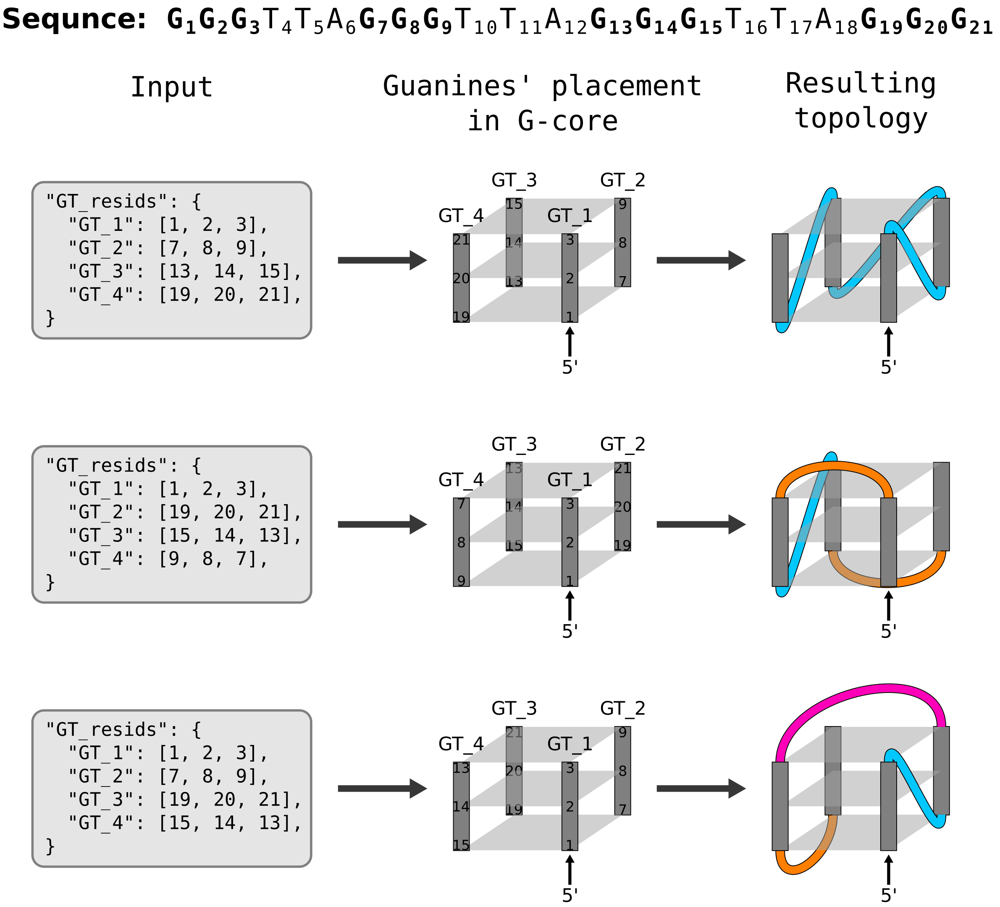
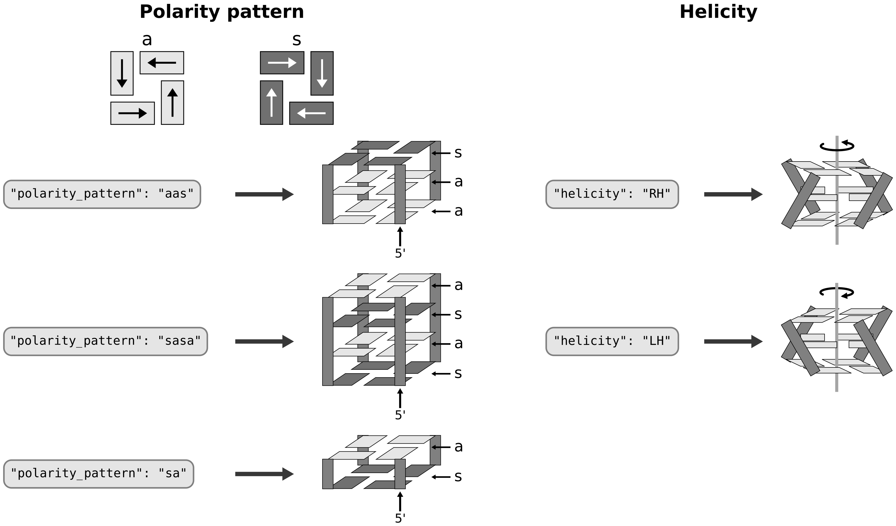
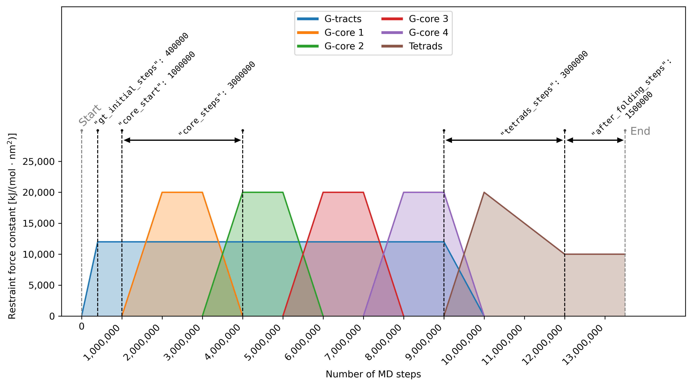

# G4 Builder

**G4 Builder** is a Python package for constructing atomistic DNA G-quadruplex (G4) structures using steered molecular dynamics with GROMACS and PLUMED. Starting from a DNA sequence and a user-defined arrangement of G-tetrads, it generates structural references and applies a sequence of RMSD restraints to guide the strand toward the specified G4 fold.

The package provides both a command-line interface (CLI) and a Python API. It can prepare simulation inputs, run the folding protocol, and extract candidate structures from the resulting trajectory. Extracted structures are ranked by their RMSD to the target G4 core.

## Installation

G4 Builder requires **Python 3.9+**, **NumPy 1.23+**, and **pandas 1.5+**. Install it from the repository directory:

```bash
python -m pip install .
```

For an editable installation, use `python -m pip install -e .` instead.

GROMACS must be installed separately and accessible as `gmx` (or through a path specified in the configuration). A **PLUMED-enabled GROMACS build** is required to run the steered MD simulation. Reference generation and PLUMED input preparation do not require GROMACS.

Check the CLI installation with:

```bash
g4-builder --help
```

The same interface is available through `python -m g4_builder`.

## Quick start: command-line interface

An example configuration is provided in [`examples/input.json`](examples/input.json). After adapting the sequence, G-tetrad arrangement, and force field, run:

```bash
# Prepare DNA coordinates, G4 references, and the PLUMED protocol.
g4-builder prepare_nogmx -i examples/input.json -w runs/example

# Generate the GROMACS topology, minimize the structure, and prepare the TPR.
g4-builder prepare -i examples/input.json -w runs/example

# Run the steered MD simulation (requires GROMACS with PLUMED).
g4-builder run_sim -w runs/example

# Extract candidate G4 structures from the trajectory.
g4-builder extract -w runs/example
```

The `prepare` command also performs the `prepare_nogmx` steps, so it can be used directly in a new working directory. The separate `prepare_nogmx` stage is useful when GROMACS is unavailable or when only reference structures and a PLUMED protocol are needed.

The `-w` argument specifies the run directory. Preparation commands read the settings from `-i`; subsequent commands use the `run.json` metadata saved in the run directory. An existing preparation can be reused with the same settings. Use a new directory when constructing a different G4 model.

If a simulation was run outside the CLI (for example, on a cluster), provide its trajectory when extracting frames:

```bash
g4-builder extract -w runs/example -trj smd.xtc -s smd.tpr -colvar COLVAR
```

Input filenames without a directory component, such as `smd.xtc`, are interpreted relative to the working directory. Absolute paths can also be supplied. For all options, see `g4-builder <command> --help`.

## Input configuration

A simulation is defined by a JSON file. For example:

```json
{
  "sequence": "GGGTAGGGCGGCGGGGCAGGGT",
  "GT_resids": {
    "GT_1": [11, 1, 2],
    "GT_2": [8, 7, 6],
    "GT_3": [19, 20, 21],
    "GT_4": [15, 14, 13]
  },
  "polarity_pattern": "ssa",
  "helicity": "RH",
  "force_field": 4
}
```

The required settings are:

| Setting | Description |
| --- | --- |
| `sequence` | DNA sequence in the 5′→3′ direction (`A`, `T`, `G`, `C`). |
| `GT_resids` | Four ordered groups of guanine residue indices specifying the G4 core. See below. |
| `polarity_pattern` | A string of `a` and `s` specifying the tetrad orientation for each layer, from bottom to top (e.g., `ssa`). |
| `helicity` | Inter-tetrad helicity: `RH` (right-handed) or `LH` (left-handed). |
| `force_field` | GROMACS force-field short name or interactive menu number. |

### Specifying the G4 arrangement

`GT_resids` determines which guanines form each G-tetrad and how they are arranged in the target core. Its four entries correspond to the four G-columns, **ordered counterclockwise** in the reference template. Within each column, residue indices are given **from the bottom tetrad to the top**. Indices are **1-based**, referring to positions in `sequence`, and may be nonconsecutive or appear in descending sequence order.

All four columns must contain the same number of guanines (at least two). This number is also the number of tetrad layers and must match the length of `polarity_pattern`. Each selected residue must be a guanine and may appear only once. The order of both columns and indices matters: do not sort them.

<p align="center">
  
  <br>
  <em><strong>Figure 1.</strong> Order of the four G-columns and the correspondence between sequence residue indices and G-tetrad layers.</em>
</p>

The `polarity_pattern` selects the predefined `a` or `s` tetrad geometry for each layer. Together with `helicity`, it defines the stacking geometry used to construct the target reference.

<p align="center">
  
  <br>
  <em><strong>Figure 2.</strong> On the left: the <code>a</code> and <code>s</code> tetrad orientations and their arrangement within a stack. On the right: right-handed and left-handed G4 stacks.</em>
</p>

**Force-field selection:** The example uses menu number `4`, which is *not* portable across GROMACS installations. Replace it with a force field available in your installation; a GROMACS short name can be used instead of a number.

### Optional settings

The defaults can be changed by adding the following fields to the JSON file:

| Setting | Default | Description |
| --- | --- | --- |
| `gromacs_executable` | `"gmx"` | GROMACS command or executable path. |
| `dielectric_const` | `15` | Relative dielectric constant (`epsilon_r`) in the simulation MDP. |
| `saving_stride` | `5000` | MD steps between trajectory frames and PLUMED COLVAR records. |
| `after_folding_steps` | `1500000` | Additional MD steps after the folding schedule. |
| `max_bulge_length` | `3` | Maximum intervening residues treated as a bulge within a G-tract reference. |
| `n_frames` | `5` | Number of low-RMSD structures to extract. |
| `schedule` | See below | Timings of the steering restraints, in MD steps. |

The optional `schedule` object controls when successive restraint groups are activated:

```json
"schedule": {
  "gt_initial_steps": 400000,
  "core_start": 1000000,
  "core_steps": 3000000,
  "tetrads_steps": 3000000
}
```

The protocol first introduces G-tract restraints, then progressively forms the G4 core with overlapping restraints, and finally applies restraints to individual tetrads. The simulation continues for `after_folding_steps` after this schedule, with tetrad restraints remaining active throughout this period. The restraint schedule is illustrated below, with a detailed description of the individual stages provided in the figure caption. The generated `plumed_protocol.dat` contains the complete restraint definitions and timings.

<p align="center">
  
  <br>
  <em><strong>Figure 3.</strong> Schematic representation of the restraint schedule used during G4 folding simulations. G-tract restraints are gradually increased to a force constant of 12,000 kJ mol⁻¹ nm⁻² over <code>gt_initial_steps</code> and maintained until the final stage of core formation. G-core restraints are introduced sequentially, starting at <code>core_start</code>. Each core reference is restrained for <code>core_steps</code>, with the force constant increasing linearly to 20,000 kJ mol⁻¹ nm⁻² during the first third of this interval, remaining constant during the second third, and decreasing to zero during the final third. Consecutive core restraints overlap by one-third of <code>core_steps</code>. Tetrad restraints are introduced at the beginning of the final third of the last core restraint. Their force constant increases to 20,000 kJ mol⁻¹ nm⁻² over <code>core_steps / 3</code>, while the G-tract restraints are simultaneously reduced to zero. The tetrad force constant then decreases linearly to 10,000 kJ mol⁻¹ nm⁻² over the remaining <code>tetrads_steps - core_steps / 3</code> steps. Finally, the tetrad restraints are maintained at 10,000 kJ mol⁻¹ nm⁻² for an additional <code>after_folding_steps</code>, after which the simulation ends.</em>
</p>

## Python API

The Python interface supports the same workflow and exposes its individual building blocks.

### Run the complete pipeline

```python
import g4_builder as g4

config = g4.SimulationConfig.from_json(
    "examples/input.json",
    working_dir="runs/api_example",
)

pipeline = g4.FoldingPipeline(config)
g4.configure_logging(pipeline.paths.log)

pipeline.prepare()              # Build strand, references, and PLUMED input.
pipeline.minimize()             # Prepare topology and run energy minimization.
pipeline.prepare_simulation()   # Generate simulation MDP and TPR.
pipeline.run()                  # Run PLUMED-enabled GROMACS.
result = pipeline.extract()     # Select and extract low-RMSD frames.

print(result.frame_paths)       # {1: Path(...), 2: Path(...), ...}
```

`SimulationConfig` can also be created directly using keyword arguments or through `SimulationConfig.from_dict(settings, working_dir=...)`. Optional settings not supplied by the user take their default values. The Python API additionally permits changing the integration timestep through `dt_ps` (default `0.002` ps).

Each pipeline stage can be called independently once its prerequisites have been completed. Successful stages update `run.json`, allowing the run to be restored in a later Python session:

```python
pipeline = g4.FoldingPipeline.from_directory("runs/api_example")

# Extract frames from a simulation executed separately.
result = pipeline.extract(
    trajectories="smd.xtc",
    structure="smd.tpr",
    colvar="COLVAR",
    n=3,
)
```

The result provides the generated file paths, completed stages, protocol duration, full-core RMSD label, and extracted-frame rankings. See [`notebooks/api_pipeline.ipynb`](notebooks/api_pipeline.ipynb) for an interactive pipeline example.

### Individual components

Strand and reference construction can also be used without the simulation pipeline:

```python
import g4_builder as g4

strand = g4.DNAStrandBuilder().build("GGGTAGGGCGGCGGGGCAGGGT")

gt_resids = {
    "GT_1": [11, 1, 2],
    "GT_2": [8, 7, 6],
    "GT_3": [19, 20, 21],
    "GT_4": [15, 14, 13],
}
references = g4.build_references("ssa", "RH", strand, gt_resids)

g4.save_pdb(strand, "strand.pdb")
references.save_full_ref("full_ref.pdb")
references.save_partial_refs(".")
```

The strand and reference coordinates are represented as pandas DataFrames. Other public components include `build_reference_template`, `build_protocol`, `GromacsPreparation`, `GromacsRunner`, and `TrajectoryFrameExtractor`. A complete step-by-step example is available in [`notebooks/api_step_by_step.ipynb`](notebooks/api_step_by_step.ipynb).

## Output files

The following files are generated in the working directory as the corresponding stages are completed:

| File | Contents |
| --- | --- |
| `strand.pdb` | Initial DNA strand. |
| `full_ref.pdb`, `ref_*.pdb` | Full G4 reference and partial references used by PLUMED. |
| `plumed_protocol.dat` | RMSD variables and steering restraints. |
| `topol.top`, `conf.pdb`, `em.pdb` | GROMACS topology, processed coordinates, and minimized structure. |
| `smd.mdp`, `smd.tpr` | Simulation parameters and compiled input. |
| `smd.xtc`, `COLVAR` | MD trajectory and PLUMED RMSD time series. |
| `frame_1.pdb`, `frame_2.pdb`, … | Candidate structures, ordered by increasing core RMSD. |
| `run.json` | Saved configuration, pipeline state, and results. |
| `gromacs.log` | Log file when logging is configured (automatically for the CLI). |

Frame selection considers only samples **at or after the end of the folding schedule**. The saved frames are ranked by RMSD to the complete G4 core reference, with `frame_1.pdb` corresponding to the lowest RMSD. The extracted PDBs are taken from the matching trajectory using GROMACS `trjconv`.

## Running simulations on a cluster

The preparation and simulation stages can be performed on different machines. After `g4-builder prepare` (or `pipeline.prepare_simulation()`), transfer the working directory to a machine with PLUMED-enabled GROMACS. Keep `smd.tpr`, `plumed_protocol.dat`, and **all reference PDBs together**.

From the run directory, the simulation can be launched directly with:

```bash
gmx mdrun -deffnm smd -cpi -v -plumed plumed_protocol.dat -c smd.pdb
```

Afterward, copy the trajectory (`smd.xtc`) and PLUMED output (`COLVAR`) back to the prepared run directory and extract frames using the CLI or Python API, supplying the trajectory path explicitly. Retain the matching `smd.tpr` for extraction. For cluster use, the GROMACS command can be included in the site's usual job-submission script.

## Scope and considerations

G4 Builder constructs structures for a **specified G4 arrangement**; it does not determine which topology is preferred by a sequence. The generated models are guided by idealized tetrad references and a restrained MD protocol, so low RMSD to the target is not, by itself, evidence of thermodynamic stability.

The supplied GROMACS preparation creates a simulation box but does **not** add explicit solvent or ions. Users should assess the force field, dielectric treatment, restraint protocol, and subsequent structural refinement for their intended application.
